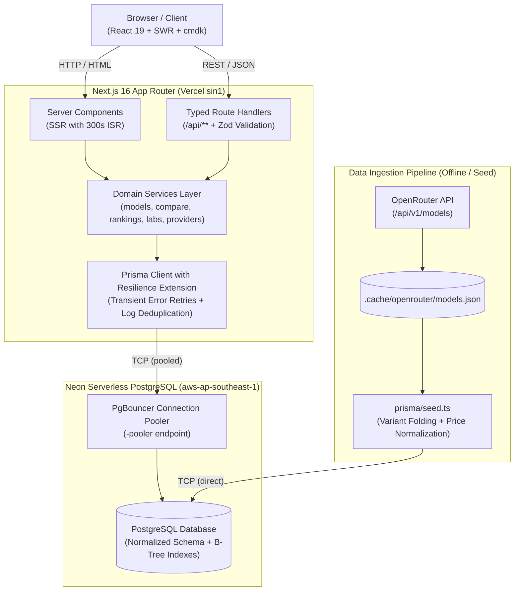
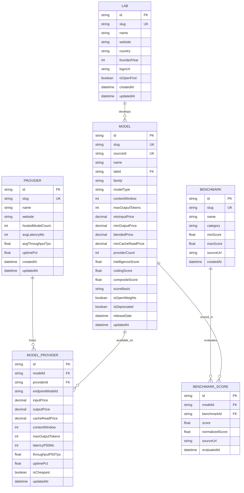

# OneAtlas — AI Model Discovery & Intelligence Platform

> **Live Platform:** [https://oneatlas.dev](https://oneatlas.dev) *(Deployment Placeholder)*  
> OneAtlas is an engineering-grade AI model intelligence platform providing developers with transparent inference pricing, latency and throughput metrics, architecture specifications, and verified empirical benchmarks across leading providers and research labs. Built on Next.js 16 (App Router), React 19, TypeScript (strict), Tailwind CSS v4, and Prisma 6 over Neon Serverless Postgres.

---

## Visual Preview

| Desktop Catalog View (1440px) | Card Grid View (1440px) |
| :---: | :---: |
|  |  |

| Mobile Responsive Table (390px) | Mobile Card Grid (390px) |
| :---: | :---: |
|  |  |

---

## Features

Mapped 1:1 against the platform's core functional requirements:

- [x] **1. Model Discovery & Catalog (Home)**
  - Comprehensive searchable directory of 448 models ingested from OpenRouter and normalized across 66 labs and 80 inference providers.
  - Multi-faceted filtering: text search with debouncing, lab selector, provider selector, model type, capability chips (`reasoning`, `tool_calling`, `structured_output`, `vision`), and free-tier toggle.
  - Dual view modes: dense tabular view with sorting across price, context, release date, and intelligence score, plus card view with capability pills.
  - Fast pagination with URL synchronization and persistent filter state.
- [x] **2. Model Detail & Developer Deep-Dive (`/models/[slug]`)**
  - Full architectural specifications: context window, max output tokens, parameter counts, license, and modalities.
  - 5-KPI strip: lowest input price, lowest output price, cache read discount, max context, and output ceiling.
  - Sortable endpoint breakdown: per-provider latency (p50), throughput (tokens/sec), uptime percentage, and endpoint quantization tags.
  - Interactive Monthly Cost Calculator with prompt caching simulation and token sliders.
  - Source-cited benchmark scores with direct links to academic papers and evaluation suites.
  - Quickstart code generator for cURL, TypeScript (OpenAI SDK), and Python.
- [x] **3. Side-by-Side Model Comparison Matrix (`/compare`)**
  - Multi-model comparison supporting 2 to 4 models simultaneously.
  - Shareable URL state (`?models=slug1,slug2,slug3`) preserving matrix configurations.
  - Pairwise winner highlighting for lowest price, highest throughput, lowest latency, and largest context with neutral tie handling.
  - Dynamic Recharts visualizations: Grouped Bar charts for benchmark scores and 5-axis Radar charts for multi-dimensional capability profiles.
  - Multi-model monthly cost projection widget highlighting the most economical model for a target workload.
  - Preset comparison scenarios (*Flagship Reasoners*, *Coding Champions*, *Open-Weights*, *Budget Fast*).
- [x] **4. Verified Rankings & Pareto Frontier (`/rankings` & `/benchmarks`)**
  - Empirical leaderboards for Composite Index, SWE-bench Verified, MMLU-Pro, GPQA Diamond, LiveCodeBench, and Artificial Analysis Intelligence Index.
  - Benchmark data: [Artificial Analysis](https://artificialanalysis.ai/) independent evaluation indices, verified vendor-reported evaluations, and LMSYS Chatbot Arena.
  - Pareto Frontier 2D scatter plot (log-scale price vs benchmark score with stepped non-dominated boundary curve) identifying cost-performance sweet spots.
  - Honest disclosure banner highlighting scored vs unscored catalog coverage.
  - Evaluation standards catalog (`/benchmarks`) documenting testing methodologies, citation sources, and min-max score normalizations.
- [x] **5. Labs & Providers Directory (`/labs`, `/providers`)**
  - Research Labs directory with founding years, headquarters, open-weight percentages, flagship releases, and interactive release cadence timelines.
  - Inference Providers directory comparing hosting endpoints, starting blended prices, throughput averages, and cheapest-host badges.
- [x] **6. Platform Architecture, Resilience & Observability**
  - Neon Serverless Postgres with PgBouncer connection pooling and automatic transient connection retries.
  - Next.js instrumentation server warmup (`SELECT 1` during boot).
  - Health probe endpoint (`/api/health`) detecting database latency and compute wake-up state (`coldStartSuspected`).
  - Command Palette (`Cmd+K` / `Ctrl+K`) for instant global fuzzy navigation across models, labs, and providers.

---

## Architecture



---

## Entity-Relationship Diagram



---

## Data Pipeline & Honesty Policy

### Ingestion & Normalization
- **Catalog Source:** The raw catalog is retrieved from OpenRouter's `/api/v1/models` endpoint and archived locally to `.cache/openrouter/models.json` for deterministic, repeatable seeding.
- **Variant Folding:** OpenRouter lists redundant per-provider suffixes (`:free`, `:extended`, `:nitro`). The seed pipeline parses these into canonical root models and normalizes endpoints into relational `ModelProvider` records.
- **Price Precision:** All prices are converted to **USD per 1 Million tokens** and rounded to 6 decimal places to prevent floating-point artifacts. Blended prices are calculated using standard 3:1 input-to-output weighting:
  $$\text{Blended Price} = (3 \times P_{\text{in}} + P_{\text{out}}) / 4$$

### Benchmark Honesty Policy
- **Verified Benchmark Sources:** Scores are strictly seeded from verified, peer-reviewed evaluation leaderboards (SWE-bench Verified, MMLU-Pro, GPQA Diamond, LiveCodeBench) and independent third-party evaluations from [Artificial Analysis](https://artificialanalysis.ai/) (Intelligence Index, Engineering Index, Domain evaluations).
- **Strict Scoring Bases (`scoreBasis: "aa" | "vendor"`):** Artificial Analysis uses a calibrated 0–100 index (where current frontier models score ~55–65), whereas vendor-reported benchmarks (MMLU-Pro, GPQA) are raw accuracy percentages from research reports where older models achieved 80–85%. To prevent misleading rankings, OneAtlas never averages or cross-ranks across different scoring bases:
  - Models with an AA Intelligence Index have `scoreBasis = "aa"`, with `intelligenceScore` and `compositeScore` set directly from that index.
  - Earlier models with only vendor-reported scores have `scoreBasis = "vendor"`, marked with a dagger (`†`) and tooltip indicating they are not comparable to the AA Index.
  - Winner logic in `/compare` only crowns winners when all compared models share the same `scoreBasis`.
- **Additive Ingestion:** Vendor-reported evaluations (`isVendorReported = true`) are preserved and never overwritten; Artificial Analysis independent evaluations (`isVendorReported = false`) fill gaps under strict deterministic model matching.
- **Coverage Disclosure:** Models lacking verified evaluations are left as `null` rather than estimated. The platform transparently displays an honesty badge and excludes unverified models from benchmark rankings.

---

## API Reference

All endpoints return a standardized envelope format:
```json
{
  "success": true,
  "data": { ... },
  "meta": { ... }
}
```

| Method | Path | Query Parameters | Description |
| :--- | :--- | :--- | :--- |
| `GET` | `/api/health` | None | System status, database ping latency, and cold-start check. |
| `GET` | `/api/models` | `page`, `limit`, `sort`, `q`, `lab`, `provider`, `capability`, `type`, `free`, `minContext`, `maxPrice` | Paginated catalog search with faceted filters. |
| `GET` | `/api/models/[slug]` | None | Full model details, specs, hosted endpoints, and benchmark scores. |
| `GET` | `/api/compare` | `slugs` (comma-separated, 2–4 models) | Pairwise comparison matrix with winners across latency, price, context. |
| `GET` | `/api/compare/presets` | None | Pre-configured popular model comparison pairings. |
| `GET` | `/api/rankings` | `benchmark`, `category` | Verified leaderboard scores and Pareto frontier efficiency points. |
| `GET` | `/api/benchmarks` | None | Benchmark suites catalog, metadata, coverage, and top 5 models. |
| `GET` | `/api/labs` | None | Research organizations with model counts and flagship models. |
| `GET` | `/api/labs/[slug]` | None | Lab profile, specifications, and chronological release timeline. |
| `GET` | `/api/providers` | None | Inference hosts with hosted model counts and starting prices. |
| `GET` | `/api/providers/[slug]` | None | Provider profile and active model endpoint specifications. |
| `GET` | `/api/search` | `q` | Fast search across models, labs, and providers for Command Palette. |
| `GET` | `/api/filters` | None | Dynamic facet counts, context size buckets, and price range minimums/maximums. |
| `GET` | `/api/stats` | None | Total models, labs, providers, and 12-month release trend breakdown. |

---

## Key Engineering Decisions & Trade-offs

1. **Denormalized Summaries on Models:**
   - *Decision:* Store `minInputPrice`, `minOutputPrice`, `blendedPrice`, and `providerCount` on the `Model` table.
   - *Trade-off:* Requires recomputing aggregate prices during ingestion updates, but eliminates heavy multi-table SQL joins and aggregation queries on high-traffic catalog listing pages.
2. **Thin Route Handlers & Fat Service Modules:**
   - *Decision:* Business logic and Prisma queries reside exclusively in `src/server/services/`.
   - *Trade-off:* Route handlers only validate input and serialize output. This allows Server Components to call service functions directly with zero HTTP network hops, while client interactions query the exact same logic over `/api`.
3. **URL Search Parameter State Synchronization:**
   - *Decision:* Store discovery filters and compare models directly in query parameters (`?q=...&models=...`).
   - *Trade-off:* Avoids client-side state divergence, enables bookmarkable URLs and shareable links, and eliminates client-server hydration desynchronization.
4. **Prisma 6 Pin with Client Extensions:**
   - *Decision:* Use Prisma 6 with classic `prisma-client-js` and `$extends` query wrappers for transient error retries.
   - *Trade-off:* Bypasses experimental preview engines in favor of proven production stability with PgBouncer connection pooling.
5. **Recharts Dynamic Client Loading (`ssr: false`):**
   - *Decision:* Load all chart components dynamically with Skeleton fallbacks.
   - *Trade-off:* Defers loading ~450KB of charting libraries until after initial page hydration, preserving sub-second First Contentful Paint.

---

## Local Setup (6 Commands)

```bash
# 1. Clone repository
git clone https://github.com/adarshthakur/oneatlas.git && cd oneatlas

# 2. Install dependencies
npm ci

# 3. Configure environment variables
cp .env.example .env
# Edit .env with your Neon Postgres credentials (DATABASE_URL and DIRECT_URL)

# 4. Generate Prisma client and push schema
npm run db:generate && npm run db:push

# 5. Ingest and seed real OpenRouter data
npm run db:seed

# 6. Start development server
npm run dev
```

Visit [http://localhost:3000](http://localhost:3000) to explore OneAtlas.

---

## NPM Scripts Reference

| Command | Action |
| :--- | :--- |
| `npm run dev` | Starts Next.js development server. |
| `npm run build` | Generates Prisma client and executes optimized production build. |
| `npm run start` | Starts Next.js production server. |
| `npm run lint` | Runs ESLint checks. |
| `npm run typecheck` | Validates TypeScript types across the entire project (`tsc --noEmit`). |
| `npm run test:api` | Executes 36-step API integration smoke test suite. |
| `npm run test:pages` | Executes 14-page end-to-end smoke test suite verifying HTTP 200/404s. |
| `npm run db:verify` | Verifies database integrity, row counts, and pricing invariants. |
| `npm run db:seed` | Runs OpenRouter catalog ingestion and seed pipeline. |

---

## Testing & Quality Assurance

OneAtlas features a multi-tiered test suite that runs against live staging and local environments:

```bash
# 1. Run typecheck & lint
npm run typecheck && npm run lint

# 2. Run unit tests for cost estimation and Pareto frontier
npx tsx scripts/test-cost-pareto.ts

# 3. Run full API integration suite
npm run test:api

# 4. Run end-to-end page smoke tests
npm run test:pages

# 5. Run database invariant verification
npm run db:verify
```

### Continuous Integration (CI) & Neon "ci" Database Branch

Every pull request and push to `main` executes the automated CI pipeline (`.github/workflows/ci.yml`):
- **Lint & Strict Typing:** Validates code standards via `npm run lint` and `npm run typecheck` (`tsc --noEmit`).
- **Fail-Early Secret Verification:** Halts immediately with a descriptive notice if the `DATABASE_URL` secret is missing from repository settings.
- **Isolated ISR Prerendering:** Because Next.js App Router prerenders static ISR catalog pages (`revalidate = 300`) at build time, the CI runner connects to a dedicated, isolated Neon Postgres branch named **`ci`** using repository secrets (`DATABASE_URL` and `DIRECT_URL`). This guarantees exact production build parity without risk to production data. See [DEPLOY.md](file:///Users/adarshthakur/Projects/oneatlas/docs/DEPLOY.md) for configuration details.

---

## Known Limitations & Production Roadmap

1. **Scheduled Catalog Synchronization:** Currently catalog ingestion is executed via CLI seed scripts. In production, a Vercel Cron or background worker will poll OpenRouter's `/api/v1/models` every 6 hours.
2. **Distributed Redis Caching:** Frequently accessed filter facets and rankings can be cached in Upstash Redis to reduce database read load during high-concurrency traffic spikes.
3. **Keyset (Cursor) Pagination:** For catalog scales exceeding 10,000 models, offset pagination (`page`, `limit`) should transition to keyset pagination (`cursor: { releaseDate, id }`) for constant $O(1)$ query execution.
4. **Rate Limiting & DDoS Protection:** Add edge rate limiting (`@upstash/ratelimit`) on `/api/search` and `/api/compare` to prevent abuse.
5. **Real-time Latency Probes:** Replace aggregate static latency figures with real-time canary inference pings executed across regional edges.
